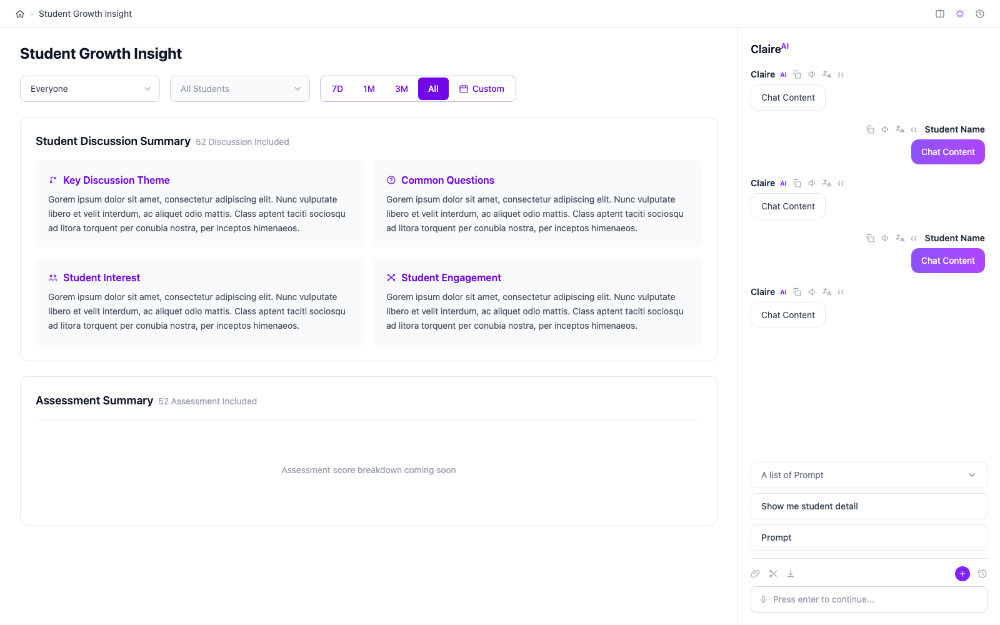

# schoolAI

School AI assisted System — a teacher-facing dashboard ("Student Growth Insight") that surfaces AI-generated insight into student discussions and assessments, alongside an AI chat assistant ("Claire AI") for digging further into a classroom or an individual student.

## What it does

A teacher picks an audience (a classroom, a specific student within it, or everyone) and a time range, and sees a summary of that scope's recent activity — discussion themes, common questions, student interest and engagement — plus a chat panel to ask Claire AI follow-up questions about what it's showing.

## Features

- **Classroom/student selection** — two dependent dropdowns (pick a classroom, then optionally narrow to one student in it); same-named students in different classrooms are still unambiguous since selection is scoped by classroom.
- **Time range filtering** — preset ranges (7D/1M/3M/All) plus a custom date range via a built-in calendar picker.
- **Student Discussion Summary** — four topic cards (Key Discussion Theme, Common Questions, Student Interest, Student Engagement).
- **Assessment Summary** — placeholder in the UI today; not yet implemented.
- **Claire AI chat** — a chat panel with prompt suggestions and a message input. The frontend UI exists; wiring it to the backend chat API is still in progress.
- **Backend API** (mock/stub data, no persistence or auth yet): classroom and student rosters (with search and cursor pagination), prebuilt prompt suggestions, chat creation and messaging (reply generation is currently a stub, not a real LLM call), and discussion summaries (currently stub content — real summary generation is a separate, not-yet-built piece of work).

## Technology

**Frontend** ([frontend/](frontend/)) — React 19, TypeScript, Vite, Tailwind CSS v4 (via `@tailwindcss/vite`), Oxlint.

**Backend** ([backend/](backend/)) — Python 3.12, FastAPI, Pydantic, pytest, uvicorn. Layered as `api/` → `services/` → `repositories/`, currently backed by in-memory mock data rather than a real database.

## Getting started

- Frontend: see [frontend/package.json](frontend/package.json) scripts (`npm run dev`, `npm run build`, `npm run lint`).
- Backend: see [backend/requirements.txt](backend/requirements.txt); run tests with `pytest` from within `backend/`.

See [.claude/CLAUDE.md](.claude/CLAUDE.md) for detailed setup commands and architecture notes on both projects.
